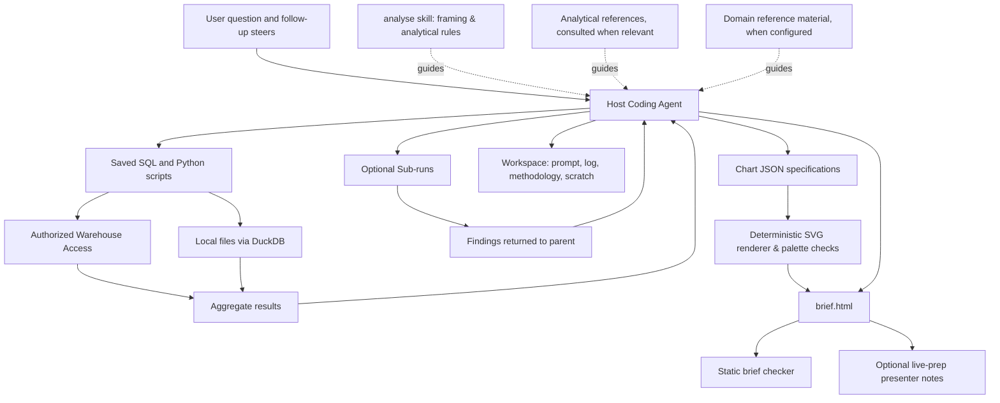

# HAL Light: Architecture and Design Rationale

HAL Light is an agent-assisted data analysis system whose orchestration lives primarily in agent instructions rather than a custom execution engine. The host coding agent supplies the reasoning loop, tool execution, and environment management; the repository supplies the analytical operating procedure, reproducibility contracts, visualization tools, and deliverable standards.

This architecture reflects a core design bet: **as models become more capable, giving the agent freedom to choose its investigative route is more valuable than prescribing its intermediate steps—provided the framework strictly defines what counts as evidence and what a finished answer must leave behind.**

---

## 1. Why HAL Became Light

HAL Light emerged from several generations of attempts to make agent-assisted analysis dependable. Each earlier generation solved real reliability problems while introducing new forms of friction.

### What earlier designs tried

1. **Multi-stage prose workflows:**
   Early versions organized analysis as an explicit sequence: frame, explore, hypothesize, test, stress-test, review, and package. Separate Markdown registers tracked hypotheses, findings, feature definitions, and open questions.
   * **What worked:** It made strong analyst habits explicit—checking denominators, testing rival explanations, and separating audience reports from private presenter notes.
   * **Why it bogged down:** Synchronization overhead. A single new finding could require updating multiple state files before reaching the deliverable. The agent spent substantial context maintaining the workflow's state alongside doing the analysis.

2. **Custom Python runtimes and compiled DAGs:**
   To eliminate manual state synchronization, responsibility moved into a Python controller backed by a per-workspace DuckDB state database. The model emitted typed execution plans (DAGs), and a deterministic runtime executed registered statistical primitives, linked evidence IDs, and enforced blocking gates on claims.
   * **What worked:** Calculations were repeatable, claims had strict programmatic lineage, and known failure modes were checked automatically.
   * **Why it bogged down:** The orchestration surface became an application that itself required debugging—state transitions, transaction retries, and mismatching status filters.

3. **Skills over a deterministic engine:**
   This approach stripped away the DAG compiler and put skills back in charge of orchestration while keeping the typed database backbone and registered statistical engine. It introduced an *output-first* policy ("annotate, never block") so uncertainty would qualify an answer rather than prevent delivery.
   * **What worked:** Much lower orchestration friction while preserving governed statistical routines.
   * **Why it bogged down:** **A method catalog becomes an analytical boundary.** Real questions routinely require an unusual join, custom normalization, a specific comparison cohort, or a bespoke combination of methods. When the agent can only express work through registered operations, answering an unfamiliar question turns into an engine-development task.

4. **Staged skills-only pipelines:**
   These intermediate projects removed the custom Python analysis engine altogether—returning Python to its role as a calculator written during a run—while keeping multi-stage file protocols (`profile → understand → frame → investigate ⇄ challenge → synthesize`).
   * **What worked:** Full analytical flexibility returned immediately.
   * **Why it bogged down:** Multi-stage JSON/Markdown handoffs still created file coordination races and stage mismatches without improving the underlying math.

### The core lessons behind Light

* **Correct computation does not settle the framing.** A registered routine can calculate an exact confidence interval for the wrong population or baseline. For example, a drop in conversion rate after a product launch might simply reflect a shift in user mix. Recomputing the aggregate confirms the arithmetic; comparing equivalent cohorts addresses the actual explanation. The consequential choice is *which question to compute next*.
* **Checks require judgment too.** Blocking gates either fire for the wrong reason (halting useful work) or verify that an evidence record exists without proving that the evidence actually answers the user's question.
* **Spend complexity on the deliverable and evidence contract, not the route.** Light strips away the custom runtime, method registry, and multi-stage state machines. Instead, it gives a capable host agent direct access to SQL and Python, while enforcing strict obligations around framing, adversarial self-checks, and reproducible workspace artifacts.

---

## 2. System Overview

In HAL Light, **the host coding agent is the application runtime.** There is no central Python controller or job scheduler executing a workflow graph. The host agent interprets the prompt, selects tools, writes SQL or Python, handles query failures, decides whether deeper investigation is required, and composes the final report.



### Entry points and environment

The repository routes supported coding agents (such as Claude Code and Codex) to a single shared implementation so instructions never drift:
* `AGENTS.md` points to `CLAUDE.md`, which directs analytical questions to the `analyse` skill.
* The canonical skills live under `.claude/skills/`, while `.agents/skills/` contains symlinks to those same directories.
* The project does not bundle a custom LLM client or database connector framework. Warehouse access is configured externally in the host environment, and `pyproject.toml` supplies the local scientific Python stack (`duckdb`, `pandas`, `numpy`, `scipy`, `scikit-learn`, `tabulate`).

### Three focused skills

Responsibilities are divided across three skills:
1. **`analyse`** — Governs problem framing, depth routing, investigation, numerical verification, workspace logging, and the finished HTML brief.
2. **`dataviz`** — Supplies visual selection guidance, a deterministic SVG chart renderer (`render.py`), and programmatic palette checks (`validate_palette.py`).
3. **`live-prep`** — Triggered on explicit request after an analysis is complete; turns the workspace record and methodology into private presenter defense notes (what to own, where to defer, and how to handle expected challenges).

### Targeted analytical references

The `analyse` skill includes short references under [`.claude/skills/analyse/references/`](../.claude/skills/analyse/references/). They develop the existing comparison and evidence obligations into guidance for recognizing particular analytical failure modes. The purpose is to make useful reasoning available when needed while keeping the skill's main instructions compact and method selection open.

| Reference | Analytical concern |
|---|---|
| [Comparison baselines](../.claude/skills/analyse/references/comparison-baselines.md) | Whether an unusual endpoint distorts the interpretation of a change |
| [Dates and cohorts](../.claude/skills/analyse/references/dates-and-cohorts.md) | Event dates, conversion maturity, incomplete observation, and changes in outcome timing |
| [Attribution](../.claude/skills/analyse/references/attribution.md) | How the process produces the outcome, and which explanatory links the evidence supports |
| [Decomposition interpretation](../.claude/skills/analyse/references/decomposition-interpretation.md) | How grouping, weighting, and allocation choices affect the meaning of a numerical split |

The routing table in `analyse/SKILL.md` tells the agent when each reference is relevant and when it is usually unnecessary. Selection follows the investigation: it begins during framing and can change as evidence reveals a new question or method. Previously read guidance remains available without routine rereading. Trivial lookups retain their lightweight path.

The references guide judgment; they introduce no fixed sequence, required statistical model, or additional run artifacts. Relevant checks use the existing evidence and logging contract. They are maintained analytical guidance, distinct from configured domain knowledge bases that describe business definitions and data sources; neither substitutes for evidence computed during the run.

---

## 3. Execution Depths and the Workspace Record

Not every question deserves a full project folder. `analyse` defines two execution depths:
* **Direct chat response:** Trivial single-metric lookups or quick counts are answered directly in the conversation.
* **Full workspace run:** Meaningful comparisons, trend analyses, driver investigations, or decision-support questions create a durable workspace under `workspaces/<date>-<slug>/`.

```text
workspaces/<date>-<slug>/
├── prompt.md                  # Original ask and chronological follow-up steers
├── run_log.md                 # Append-only decision log, checks, and script pointers
├── methodology.md             # Coherent explanation of sources, cohorts, and math
├── brief.html                 # Canonical, self-contained audience deliverable
├── scratch/
│   ├── queries.sql            # Saved warehouse or DuckDB queries
│   ├── analysis.py            # Custom statistical or modeling scripts
│   ├── aggregate_results.json # Intermediate aggregate outputs
│   ├── chart_specs.json       # Input specifications for render.py
│   └── charts/                # Generated SVG files prior to inline embedding
└── analyse/                   # Optional child workspaces for composable sub-runs
    └── <sub-question>/
```

### Why the workspace is structured for distinct readers

Each artifact in the workspace serves a specific consumer:

| Artifact | Target Reader | Architectural Purpose |
| :--- | :--- | :--- |
| `brief.html` | Decision-maker / Audience | Delivers the headline answer, supporting evidence, inline SVG charts, and tables in a single portable file. Follow-up steers update this canonical file in place rather than spawning `final_v2` copies. |
| `methodology.md` | Peer Reviewer / Analyst | Explains how the answer was computed, why specific baselines were chosen, and what limitations remain—without forcing the reader to parse chronological dead ends. |
| `run_log.md` | Auditor / Future Agent | Records decisions, failed hypotheses, corrections, and links to exact files in `scratch/` as they happen. |
| `scratch/` | Reproducibility Runner | Holds the actual SQL and Python code so any reported number can be recomputed without reconstructing a chat transcript or querying a proprietary evidence database. |
| `prompt.md` | Scope Checker | Preserves the exact initial prompt and subsequent user steers so the final brief can be audited for completeness before shipping. |

### Composable sub-runs

When an investigation uncovers a substantial side question (for example, stress-testing a forecast buffer or running a complex sensitivity analysis), the parent run can spawn a child workspace under `workspaces/<parent>/analyse/<sub-question>/`.

The child follows the exact same workspace contract (`prompt.md`, `run_log.md`, `methodology.md`, `scratch/`). It can return a structured findings summary to the parent without generating a separate audience-facing `brief.html`. This keeps long robustness investigations from exhausting the parent agent's context window while preserving full auditability.

The parent handoff includes applicable definitions and reusable aggregates with their instrument pointers. A child can challenge that frame; the parent reconciles changed definitions before combining findings.

---

## 4. Data Architecture and Privacy Boundaries

A core architectural principle of HAL Light is **separating where computation happens from what the model inspects.** Detailed row-level records may be joined, scored, and filtered inside the data warehouse or local DuckDB engine, but the default output returned to the agent's context and deliverables is **aggregate**.

For example, if an analysis requires evaluating a churn model, a query or local DuckDB script can score individual customers and return counts by risk bucket for calibration and targeting summaries. Exact AUC requires retaining score ordering and ties in the computation; coarse deciles generally give an approximation. Compute the metric where the detailed scores reside and return the summary. The model interprets performance metrics without exposing raw customer rows in the conversation.

### Five sanctioned data paths

1. **Direct warehouse aggregation:** Push joins, window functions, and cohort filtering into authorized warehouse SQL; return summary tables.
2. **Local analytical files via DuckDB:** Query local CSV and Parquet files using DuckDB for aggregation. Excel inputs require an appropriate extension or conversion step.
3. **Hybrid aggregate joins:** Pull aggregated cuts from the warehouse into local files for statistical testing, regression, or simulation in Python.
4. **Authorized row-level extracts (Exception path):** When a statistical method genuinely cannot be expressed over aggregates or in-warehouse SQL, the agent must request explicit user permission for that run, extract only minimal required columns without PII, emit aggregate script outputs, and delete the extract upon completion.
5. **Quarantined text sub-runs (Exception path):** When reading unstructured text (such as support tickets or survey responses) *is* the analysis, work is isolated in a dedicated sub-run that returns only counted themes and categorical summaries—never verbatim quotes or personal identifiers—to the parent analysis.

---

## 5. Analytical Quality Obligations

Because HAL Light does not restrict the agent to a pre-registered catalog of statistical functions, it enforces analytical rigor through mandatory investigative steps tied to the answer. These rules target framing and reasoning errors that ordinary software unit tests cannot catch.

### The Framing Contract

Before computing a number that will anchor the final answer, the agent must explicitly state:
1. **Quantity:** The exact metric or effect being estimated.
2. **Population:** The specific cohort, unit of analysis, and eligibility rules.
3. **Comparison / Baseline:** The control group, prior period, or counterfactual design.
4. **Decision Output:** What the user actually needs to decide or know.

Framing can change when evidence or user steers change the estimand, population, comparison, or decision output. The agent records the revision and updates affected calculations while preserving the user's intended question; it explains any part the revised analysis cannot answer.

### Mandatory Discriminating Checks

| Obligation | Failure Mode Addressed | What the Agent Must Do |
| :--- | :--- | :--- |
| **Challenge the Framing** | Accurate arithmetic applied to a misleading comparison (e.g., Simpson's paradox, mix shift, seasonality). | Name the strongest alternative explanation for the initial result and actively compute a fairer comparison (e.g., cohort-matched rates, common support), or cite the exact missing data that prevents it. Merely adding a prose caveat is insufficient when a check can be computed. |
| **Recommendation Flip Test** | A recommendation resting on an untested, decisive confounder or assumption. | Identify and run the single check most likely to reverse or invalidate the proposed recommendation. |
| **Independent Headline Recomputation** | Bugs in complex SQL window functions, join fan-out, or script logic. | Recompute the headline figure via a second, independent calculation path (e.g., verifying a complex SQL rate via a separate Python aggregation over base totals). |
| **Decomposition Reconciliation** | Subgroup breakdowns or waterfall charts whose parts do not sum to the reported headline change. | Explicitly reconcile component totals against the aggregate headline before reporting. |
| **Material Residual Investigation** | Hiding large unexplained variance inside an "Other" bucket or footnote. | Investigate any residual or "unexplained" bucket that is large enough to rival the primary reported drivers. |
| **Query Failure vs. Empty Result** | Mistaking missing table permissions, broken joins, or timeout errors for "zero occurrences." | Explicitly distinguish execution/access errors from verified zero-count results. |
| **Final Coverage Audit** | Exploration drift that answers an interesting side question while omitting part of the user's ask. | Re-read `prompt.md` (including all follow-up steers) against `brief.html` before closing the run. |

---

## 6. Presentation Layer and Deterministic Helpers

While analytical investigation should remain open-ended, generating SVG coordinates, checking color contrast, and verifying HTML structure are bounded deterministic tasks. HAL Light offloads those tasks to small, tested Python scripts.

### Self-contained HTML deliverables (`brief.html`)

The deliverable starts from `brief_template.html` and produces a single static HTML file using inline CSS and system fonts—no JavaScript, no external stylesheets, and no network dependencies. Every charted series must also be backed by an accessible data table in the brief. This ensures the report can be emailed, archived, or viewed offline without a running server or agent session.

### Chart rendering and visual selection (`dataviz`)

```text
Aggregate data → Agent selects visual form & writes chart_specs.json
               → render.py validates schema & computes SVG geometry
               → validate_palette.py validates perceptual contrast & CVD separation
               → Agent embeds inline <svg> into brief.html
```

* **Form follows question:** The agent chooses the visual form based on the analytical relationship (trend, rank, part-to-whole, variance).
* **`render.py`:** Deterministically renders five common forms: line, vertical bar, horizontal bar, waterfall, and combo charts. It validates series lengths, escapes text, sanitizes filenames, calculates axes/labels, and writes clean SVG with scoped styling. If the right visualization is outside those five forms (e.g., a Marimekko or custom scatter plot), the agent is explicitly permitted to author bespoke SVG rather than forcing the data into an ill-fitting bar chart.
* **`validate_palette.py`:** Evaluates candidate color palettes across perceptual lightness, chroma, background contrast, and pairwise color separation—including simulated protanopia and deuteranopia as pass/fail checks, with tritanopia separation reported for review. It distinguishes between adjacent-color checks (for stacked bars) and all-pairs checks (for multi-line charts where any two series may cross).

### Static brief verification (`verify_brief.py`)

Before finishing, the agent runs `verify_brief.py` against `brief.html`. The script parses HTML to catch mechanical omissions:
* Leftover template comments or `TODO` / placeholder markers.
* Missing `html`/`body` structure; warnings for missing headings, charts, tables, short text, or absent methodology/caveat cues. It does not validate section completeness or metadata.
* Disallowed `<script>` tags or external `http://` / `https://` asset dependencies.

---

## 7. Enforcement Model and Architectural Tradeoffs

Understanding HAL Light requires distinguishing between what is **enforced by deterministic code** and what is **governed by agent instructions and inspectable records.**

| System Property | Primary Mechanism | Verification / Enforcement |
| :--- | :--- | :--- |
| Valid chart geometry, series lengths, & text escaping | `render.py` (Python) | Deterministic validation + automated unit tests (`test_helpers.py`). |
| Perceptual color contrast & CVD separation | `validate_palette.py` (Python) | Deterministic calculation when invoked during the dataviz workflow. |
| Absence of `<script>` tags, external asset dependencies, & template placeholders | `verify_brief.py` (Python) | Static HTML parser check prior to completion (citation hyperlinks and relative local assets are permitted by the parser; `<script>` rejection is a structural check rather than a full security sanitizer). |
| Correct cohort definition, baseline choice, & rival framing | `analyse` skill instructions | Agent reasoning, made visible for human inspection in `methodology.md` and `run_log.md`. |
| Relevant reference selection & application | `analyse` routing table + analytical references | Agent judgment; no runtime loads the references automatically or verifies that their guidance was applied correctly. |
| Independent headline recomputation & flip tests | `analyse` skill instructions | Agent compliance, backed by concrete scripts saved in `scratch/`. |
| Aggregate-only data boundary & workspace isolation | `analyse` skill instructions + external warehouse IAM | Agent compliance; there is no local runtime proxy intercepting every SQL query or file write. |

### Risks of the reference layer

References expand the instructions that can influence an analysis. Moving guidance out of `SKILL.md` does not reduce the scrutiny it deserves, especially when its wording creates a new obligation.

- **Workflow creep:** Accumulated checks can recreate the prescribed pipeline Light moved away from. Keep guidance conditional on the question and consequential uncertainty; a method mentioned in a reference is not a default requirement.
- **Overgeneralization and anchoring:** A lesson from one case can become an invalid universal rule, while a narrow example can make the agent miss the same failure elsewhere. State the general failure mechanism and its limits; avoid treating business categories or example parameters as analytical invariants.
- **Context and query cost:** Broad triggers or routine rereading can load every file and provoke unnecessary work. Clear applicability boundaries, reuse of existing evidence, and proportionate investigation are intended to limit that cost.
- **Instruction drift:** Repeated guidance can diverge across the skill and references. Keep topic-specific detail in its owning reference and routing and standing obligations in the skill; review their consistency when either changes.
- **False assurance:** Reading a reference does not establish a sound comparison or causal explanation. Any claimed improvement needs evidence from actual analyses; structural validation of the documents cannot establish analytical quality.

### Why this tradeoff works

In earlier heavy architectures, attempting to enforce analytical judgment in Python required forcing every hypothesis, data transformation, and statistical check through a rigid schema. That prevented bad formatting, but it also prevented the agent from writing the exact five lines of DuckDB SQL or SciPy code needed to test a nuanced domain confounder.

HAL Light places deterministic code where software excels—geometry, color math, and DOM linting—and places structured procedural obligations where reasoning excels. While the repository cannot programmatically guarantee that an agent chose the single best causal design, its instructions require that **every framing choice, rival check, and underlying calculation be written down in ordinary files where a human reviewer—or a follow-up agent pass—can immediately inspect and rerun it.**
